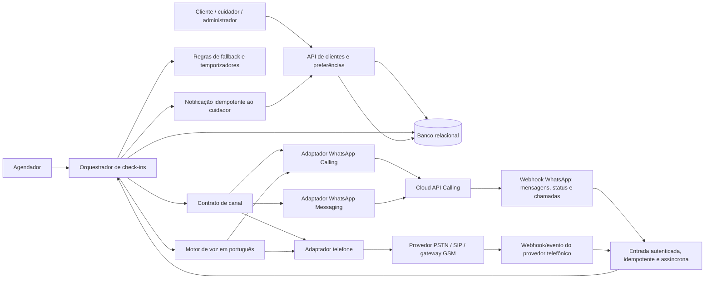

# Proposta de arquitetura multicanal

**Estado: MVP local implementado com interface em português, API FastAPI e SQLite. Telefone, WhatsApp e notificações são simulados; integrações reais, autenticação e operação em produção ainda não foram implementadas.**

Este documento descreve a arquitetura pretendida para dados, canais, API e evolução do ESTOU BEM. O MVP atual é somente uma demonstração local e não implementa os fluxos de produção aqui propostos.

## 1. Verificação da plataforma WhatsApp da Meta

Verificado na documentação oficial da Meta em 20/11/2026. A disponibilidade e as políticas podem mudar; confirmar novamente os requisitos, termos e tabelas de preços antes de ativar cada integração.

### Chamadas de voz do WhatsApp

- Existe uma **WhatsApp Business Calling API** oficial para chamadas VoIP iniciadas pelo negócio e pelo usuário. Não é uma capacidade da API comum de mensagens nem se deve simular uma chamada enviando áudio.
- Para uma chamada iniciada pelo negócio, o caminho Cloud API usa `POST /<PHONE_NUMBER_ID>/calls`, negociação SDP e webhooks de chamada para sinalização/estado. O servidor da aplicação precisa estabelecer o transporte de mídia em tempo real (WebRTC, ICE/DTLS/SRTP, codec OPUS por padrão) e processar o áudio para executar a interação de voz em português.
- SIP também é uma opção oficial de sinalização, mas exige configuração própria. Quando SIP está habilitado, os endpoints de chamada Graph deixam de ser utilizáveis e os webhooks de chamada não são enviados por padrão; portanto esta proposta escolhe Graph API + Webhooks + WebRTC para o primeiro adaptador. Asterisk ou gateway SIP só deve ser considerado após uma prova de compatibilidade de mídia e protocolo; não se presume compatibilidade nativa.
- Pré-requisitos documentados incluem portfólio empresarial Meta, WhatsApp Business Account, Messaging Account, aplicativo empresarial e número comercial ativo na Cloud API (não apenas no WhatsApp Business App), chamadas habilitadas no número, limite de mensagens da conta de pelo menos 2.000 destinatários únicos por dia, permissão `whatsapp_business_messaging` e assinatura do aplicativo aos webhooks `calls` e de mensagens para a conta. `whatsapp_business_management` é necessário para gestão de templates/metadados e outros webhooks de conta; se a plataforma acessar ativos pertencentes aos clientes como parceira, serão necessários App Review e acesso avançado às permissões aplicáveis.
- A pessoa deve permitir que a empresa ligue. A permissão de chamada é controlada pelo usuário e pode ser temporária (168 horas) ou permanente; pode ser concedida por solicitação, perfil comercial ou callback configurado. Registremos essa permissão separadamente do consentimento para receber mensagens. A exceção de chamada baseada em qualidade é limitada a números comerciais elegíveis em mercados específicos (a documentação atual menciona Colômbia e México) e não deve ser assumida como disponível.
- Existem limites, incluindo até 100 chamadas conectadas por período de 24 horas para cada par número comercial/usuário na regra documentada; chamadas não atendidas consecutivas podem gerar avisos e revogação automática da permissão. A orquestração deve respeitar webhooks e erros da Meta, interromper tentativas quando a permissão for revogada e permitir substituição por outro canal.
- Chamadas iniciadas pelo negócio são cobradas por duração em pulsos de seis segundos (fração de pulso arredondada para cima), país do número chamado e faixa mensal de volume; é necessário método de pagamento válido. Chamadas iniciadas pelo usuário são gratuitas. Não foi fixado custo unitário nesta proposta: usar a tabela vigente da moeda/mercado da conta e verificar também custos do provedor de mídia/infraestrutura.

### Mensagens interativas do WhatsApp

- A Cloud API suporta mensagens interativas com até três botões de resposta rápida; a seleção chega em webhook `messages` como `button_reply`.
- Uma mensagem de check-in enviada proativamente deve usar um template aprovado quando não houver janela de atendimento aberta. A aprovação, idioma, categoria e componentes do template são geridos por conta do WhatsApp/Messaging. A proposta prevê um template de categoria utilitária em português com os três botões exigidos, sujeito à aprovação efetiva da Meta; mensagem enviada/aceita pela API não prova entrega nem resposta.
- Fora da janela de atendimento de 24 horas aberta por mensagem ou chamada da pessoa, mensagens livres não podem iniciar uma conversa; use template aprovado. Essa janela Meta é distinta do prazo de resposta do check-in definido pelo produto.
- É obrigatório obter opt-in antes de enviar mensagens, deixando claro o nome da empresa e o tipo de comunicação, e cumprir a legislação aplicável. O custo de mensagens depende da categoria (por exemplo, utilitária) e do mercado; a Meta cobra por mensagem comercial entregue, não apenas enviada. Respostas do usuário não são cobradas pela Meta. O provedor de telefonia convencional também terá tarifas próprias, que dependem do fornecedor e destino; devem ser comparadas separadamente.

### Requisitos operacionais e segurança

- O adaptador WhatsApp deve verificar a autenticidade das notificações segundo a documentação vigente, deduplicar eventos e responder rapidamente ao webhook; a lógica de negócio ocorre em processamento assíncrono.
- Tokens de acesso e credenciais de provedores ficam exclusivamente no backend, em armazenamento de segredos. Nunca devem ser incluídos em frontend, respostas de API, logs ou exemplos de configuração versionados.
- As mensagens proativas exigem opt-in, template ativo/aprovado e configuração válida da conta. Falha de entrega, falta de permissão de chamada, rejeição, erro de mídia ou webhook atrasado nunca equivalem a `OK`.

### Fontes oficiais consultadas

- [Cloud API Calling: overview e pré-requisitos](https://developers.facebook.com/documentation/business-messaging/whatsapp/calling)
- [Chamadas iniciadas pelo negócio](https://developers.facebook.com/documentation/business-messaging/whatsapp/calling/business-initiated-calls)
- [Permissões de chamada do usuário](https://developers.facebook.com/documentation/business-messaging/whatsapp/calling/user-call-permissions)
- [Configuração de chamadas](https://developers.facebook.com/documentation/business-messaging/whatsapp/calling/call-settings)
- [SIP para WhatsApp Calling](https://developers.facebook.com/documentation/business-messaging/whatsapp/calling/sip)
- [Preços de chamadas](https://developers.facebook.com/documentation/business-messaging/whatsapp/calling/pricing)
- [Opt-in do WhatsApp](https://developers.facebook.com/documentation/business-messaging/whatsapp/getting-opt-in)
- [Mensagens interativas com botões](https://developers.facebook.com/documentation/business-messaging/whatsapp/messages/interactive-reply-buttons-messages)
- [Templates: fundamentos e aprovação](https://developers.facebook.com/documentation/business-messaging/whatsapp/templates/overview)
- [Mensagens, janela de atendimento e cobrança](https://developers.facebook.com/documentation/business-messaging/whatsapp/messages/send-messages)
- [Webhooks do WhatsApp](https://developers.facebook.com/documentation/business-messaging/whatsapp/webhooks/overview)
- [Preços de mensagens](https://developers.facebook.com/documentation/business-messaging/whatsapp/pricing)
- [Permissões da plataforma](https://developers.facebook.com/documentation/business-messaging/whatsapp/permissions)

## 2. Arquitetura proposta

Cada check-in é uma operação de domínio única, coordenada por um orquestrador. Os canais implementam um contrato comum, mas mantêm adaptadores, credenciais, estados de entrega, eventos e testes independentes. O canal preferido é tentado primeiro; uma regra configurada pode iniciar uma tentativa em outro canal após falha/timeout. Nenhum envio, aceite de API ou estado de entrega encerra o check-in como confirmado.



### Contrato comum dos canais

O contrato de domínio deve receber o contexto do check-in e retornar uma tentativa criada, não um resultado de saúde. Eventos normalizados incluem `accepted`, `delivered` (quando disponível), `ringing`, `connected`, `response_received`, `failed`, `rejected` e `ended`. A resposta semântica é separada: `OK`, `HELP` ou `POSTPONE`. Cada adaptador converte eventos do seu provedor para esse modelo e oferece seu próprio simulador/testes de contrato.

- **Telefone:** disca telefone fixo ou móvel por provedor PSTN, SIP/Asterisk ou gateway GSM compatível. Usa lógica de voz em português e reconhece resposta falada ou DTMF/teclado. Não depende do WhatsApp.
- **WhatsApp Calling:** chamadas de saída Cloud API, com servidor de mídia WebRTC e lógica de voz própria em português. Os webhooks de `calls` alimentam estados da chamada; apenas uma resposta reconhecida durante a chamada pode confirmar ou acionar ajuda/adiamento.
- **WhatsApp Messaging:** envia template utilitário aprovado com respostas rápidas `ESTOU BEM`, `PRECISO DE AJUDA` e `NÃO POSSO RESPONDER AGORA`. Interpreta IDs estáveis de botão, não texto editável. Aguarda a janela de resposta do produto e então registra `UNANSWERED` se não houver resposta válida.

## 3. Modelo de dados proposto

Esquema lógico (nomes e tipos são propostas, não migrações). Usar banco relacional transacional. Horários persistidos em UTC; guardar fuso IANA do cliente para agendamento e exibição.

| Tabela | Campos e regras principais |
| --- | --- |
| `customers` | `id`, dados de contato, `timezone`, `preferred_checkin_channel` (`telephone`, `whatsapp_call`, `whatsapp_message`), `response_window_seconds`, `postpone_retry_after_seconds`, `created_at`, `updated_at`. Mudança de preferência permitida por API autorizada; aplicada a novos check-ins e tentativas ainda não iniciadas, nunca reescreve o histórico. |
| `checkins` | `id`, `customer_id`, `scheduled_for`, `started_at`, `response_deadline_at`, `completed_at`, `final_outcome` (`OK`, `HELP_REQUESTED`, `POSTPONED`, `UNANSWERED`), `final_channel`, `response_at`, `response_value`, `retry_count`, `idempotency_key`, `created_at`. Unicidade por chave idempotente e por cliente/horário de ocorrência impede criação concorrente de check-ins duplicados. |
| `checkin_attempts` | `id`, `checkin_id`, `attempt_number`, `channel`, `provider`, `status`, `response_outcome` (`OK`, `HELP_REQUESTED`, `POSTPONED`, `UNANSWERED`), `started_at`, `accepted_at`, `delivered_at`, `ringing_at`, `connected_at`, `ended_at`, `response_at`, `external_message_id`, `external_call_id`, `failure_code`, `failure_detail_redacted`, `retry_of_attempt_id`. Unicidade de `(checkin_id, attempt_number)`; preservar um registro por envio/chamada real. |
| `checkin_events` | `id`, `checkin_id`, `attempt_id`, `source`, `event_type`, `occurred_at`, `received_at`, `external_event_key`, `payload_reference` minimizado. Unicidade de `(source, external_event_key)` para idempotência; se o provedor não fornecer ID de evento, derivar chave determinística dos identificadores/evento/timestamp e nunca presumir que o webhook chegará uma única vez. |
| `channel_consents` | `id`, `customer_id`, `channel`, `purpose`, `status`, `granted_at`, `revoked_at`, `source`, `evidence_reference`, `notice_version`, `recorded_by`. Registro de opt-in WhatsApp para mensagens separado do consentimento/opt-in para comunicações por telefone; preservar evidência e revogação. |
| `whatsapp_call_permissions` | `id`, `customer_id`, `business_phone_number_id`, `permission_type` (`temporary`, `permanent`), `status`, `granted_at`, `expires_at`, `revoked_at`, `source`, `meta_event_reference`. Separado do opt-in de mensagens e atualizado por eventos explícitos; validar validade e elegibilidade antes de cada chamada. |
| `fallback_policies` | `id`, `scope` (`customer`, `administrator`), `customer_id` opcional, `enabled`, `priority`, `trigger` (`delivery_failed`, `call_failed`, `response_timeout`), `next_channel`, `max_attempts`, `wait_seconds`, `updated_at`. Restrição para sequência sem ciclos; política do cliente sobrepõe a padrão administrativa quando definida. |
| `message_templates` | `id`, `provider`, `template_name`, `language`, `category`, `approval_status`, `provider_template_id`, `version`, `updated_at`. Só selecionar template aprovado e ativo; não armazenar credencial do provedor. |
| `caregiver_notifications` | `id`, `checkin_id`, `caregiver_id`, `reason`, `status`, `created_at`, `sent_at`, `provider_notification_id`. Chave única `(checkin_id, caregiver_id, reason)` evita alertas de emergência duplicados para o mesmo evento. |
| `webhook_receipts` | `id`, `provider`, `external_event_key`, `received_at`, `processed_at`, `processing_status`, `error_code`. Chave única `(provider, external_event_key)` evita reprocessamento e permite retentativa explícita de processamento com falha. Não guardar tokens nem payload sensível bruto por padrão. |

`POSTPONED` não significa confirmação: grava a resposta e programa nova tentativa/ocorrência conforme a política, com contagem e vínculo ao check-in original. `HELP_REQUESTED` dispara alerta ao cuidador em transação idempotente. Quando expira a janela de resposta do WhatsApp sem resposta, a tentativa do WhatsApp recebe imediatamente `response_outcome = UNANSWERED`; isso nunca é interpretado como `OK`. Uma política de fallback pode iniciar outra tentativa, cujo resultado explícito fica registrado separadamente. O resultado final do check-in só pode ser definido como `OK` por resposta positiva explícita em uma tentativa elegível; se nenhuma tentativa de fallback produzir resposta explícita, o `final_outcome` é `UNANSWERED`. Falha de entrega fica registrada na tentativa e pode acionar fallback, sem marcar resposta positiva.

## 4. API proposta

Contratos HTTP independentes do framework; autenticação, autorização por papel e isolamento de dados do cliente são requisitos transversais.

| Método e rota | Uso |
| --- | --- |
| `GET /api/v1/customers/me/checkin-preferences` | Consultar canal preferido, janela de resposta, retentativa e canais habilitados. |
| `PATCH /api/v1/customers/me/checkin-preferences` | Alterar `preferred_checkin_channel`; validar contato, consentimento e capacidade do canal. Alteração não concede opt-in nem permissão de chamada automaticamente. |
| `GET /api/v1/checkins/{id}` | Consultar resultado, tentativas, timestamps e canal, sem expor payload bruto ou credenciais. |
| `GET /api/v1/customers/me/checkins` | Histórico paginado de check-ins e seus resultados. |
| `PUT /api/v1/customers/me/consents/{channel}/{purpose}` | Conceder, atualizar ou revogar consentimento, registrando origem, texto/versão de aviso e timestamp. A permissão de chamadas WhatsApp é refletida apenas a partir de prova/estado verificável da plataforma, não deste endpoint sozinho. |
| `PUT /api/v1/admin/customers/{id}/fallback-policy` | Administrador define política de fallback do cliente, limites e prazos, com auditoria. |
| `GET /api/v1/admin/fallback-policy` / `PUT /api/v1/admin/fallback-policy` | Consultar/alterar política padrão administrativa. |
| `GET /api/v1/webhooks/whatsapp` | Verificação inicial do endpoint conforme o protocolo Meta configurado. |
| `POST /api/v1/webhooks/whatsapp` | Receber `messages` (respostas e status) e `calls` (sinalização/estado); validar origem, persistir recibo idempotente e enfileirar processamento. |
| `POST /api/v1/webhooks/telephony/{provider}` | Receber estados de chamada/DTMF ou eventos do provedor telefônico; autenticar segundo o mecanismo do provedor. |

O agendador cria cada check-in com chave idempotente baseada na ocorrência. O processamento de webhook associa resposta à tentativa/check-in pela mensagem ou chamada externa e pelo destinatário; respostas tardias não podem alterar um resultado final ou causar uma segunda notificação sem política explícita. Os IDs internos de botões são constantes (`checkin_ok`, `checkin_help`, `checkin_postpone`) e mapeiam aos rótulos em português.

## 5. Estrutura de pastas proposta

Estrutura lógica, a adaptar ao stack escolhido após aprovação:

```text
src/
  domain/
    checkins/                 # estados, respostas, regras de resultado
    channels/                 # contrato e eventos normalizados
    consent/                  # opt-in, permissões e revogação
    fallback/                 # política e validação de ciclos/limites
  application/
    schedule-checkin/
    start-checkin/
    handle-channel-event/
    notify-caregiver/
    change-preferences/
  adapters/
    channels/
      telephone/              # provedor PSTN/SIP/GSM e IVR
      whatsapp-call/          # Calls API, sinalização WebRTC e mídia
      whatsapp-message/        # templates, botões e status
    webhooks/
      whatsapp/
      telephony/
    persistence/
    notifications/
  voice/
    pt/                        # prompts e reconhecimento de resposta em português
  api/
    customers/
    checkins/
    admin/
    webhooks/
  jobs/                        # agendamento, timeouts e retentativas
  config/                      # referências a segredos, sem valores secretos
tests/
  contract/channels/
  integration/webhooks/
  integration/checkins/
  unit/
docs/
  proposta-arquitetura-multicanal.md
```

## 6. Roadmap proposto (sujeito à aprovação)

1. **Aprovar arquitetura e decisões de produto:** stack, provedor PSTN/telefonia, mercados de operação, retenção de dados, janela de resposta/retry e papéis de cliente/cuidador. Validar regras locais de privacidade/telecomunicações.
2. **Base de domínio e persistência:** esquema, migrações, idempotência, trilha de eventos, permissões/autorização, consentimentos independentes e preferências editáveis.
3. **Orquestrador e canal telefone:** contrato de canal, agendamento, prompts em português, fala/DTMF, eventos do provedor e notificação idempotente ao cuidador.
4. **WhatsApp Messaging:** onboarding Meta, opt-in, template utilitário aprovado em português com três botões, status e webhooks de resposta; validar prazo de resposta, `UNANSWERED`, adiamento e fallback.
5. **WhatsApp Calling — prova de conceito primeiro:** elegibilidade real da conta/número/mercado, permissões do usuário, configuração de pagamento e `calls` webhook; validar mídia WebRTC bidirecional, voz em português e limites. Só promover após critérios de qualidade, segurança e custo aprovados. SIP/Asterisk permanece alternativa futura, sujeita a prova própria.
6. **Fallback, painel e robustez:** configuração do cliente/administrador, alteração do canal preferido, retentativas com limites, reconciliação de eventos fora de ordem/duplicados, métricas e auditoria.
7. **Piloto controlado e produção:** números e clientes de teste, validação de custos de telefonia e Meta, revisão de consentimento, testes de indisponibilidade, alertas e plano de reversão. Nenhum canal entra em produção sem opt-in/permits necessários e teste de ponta a ponta.

### Critérios mínimos de aceite

- Os três valores de `preferred_checkin_channel` são selecionáveis e editáveis com autorização.
- Os três adaptadores podem ser testados e substituídos sem alterar regras de resultado do check-in.
- Apenas resposta explícita `ESTOU BEM`/resposta falada ou DTMF reconhecida registra `OK`; o botão de ajuda alerta uma única vez; adiamento cria tentativa futura e não confirma o estado.
- Ausência de resposta dentro da janela definida registra `UNANSWERED`; falha, aceite ou entrega da mensagem/chamada não registra `OK`.
- Repetir agendamento ou webhook não cria check-in, resposta ou alerta duplicado.
- Fallback respeita consentimento/permissão e limites do canal, grava cada tentativa e não transforma falha de um canal em sucesso.
- Tokens e credenciais não aparecem no cliente web, respostas da API, logs ou arquivos versionados.
